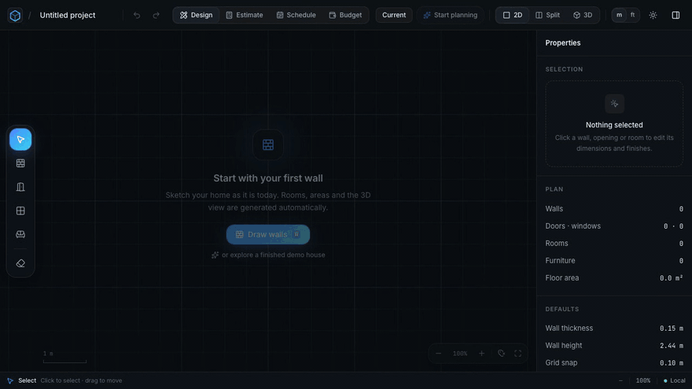
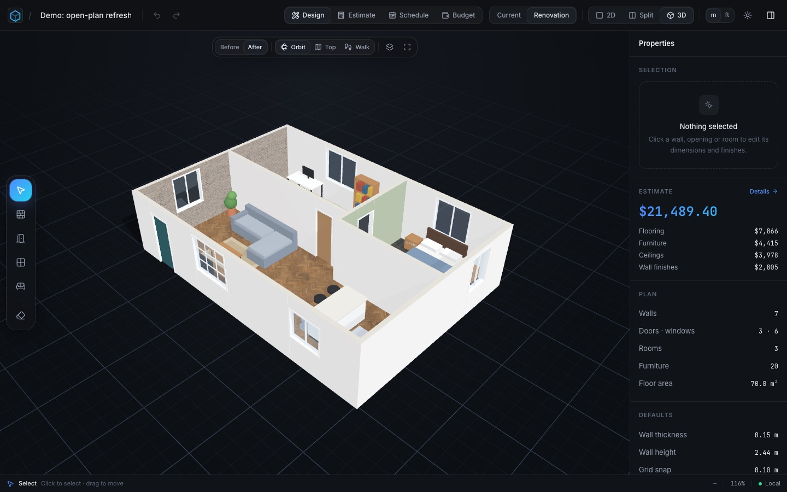
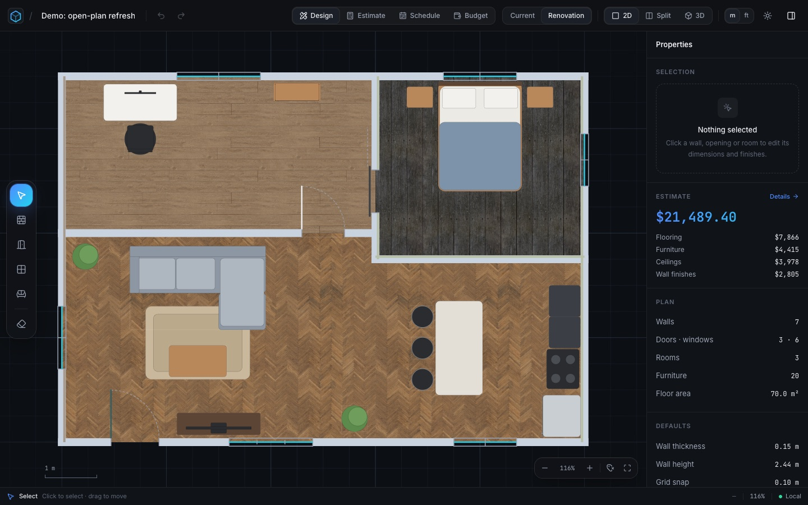
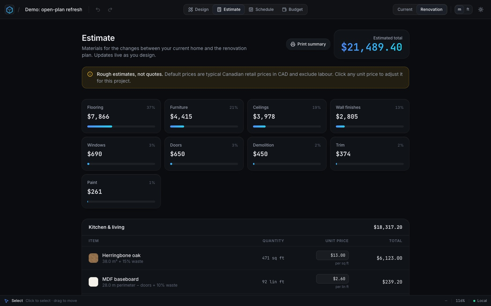
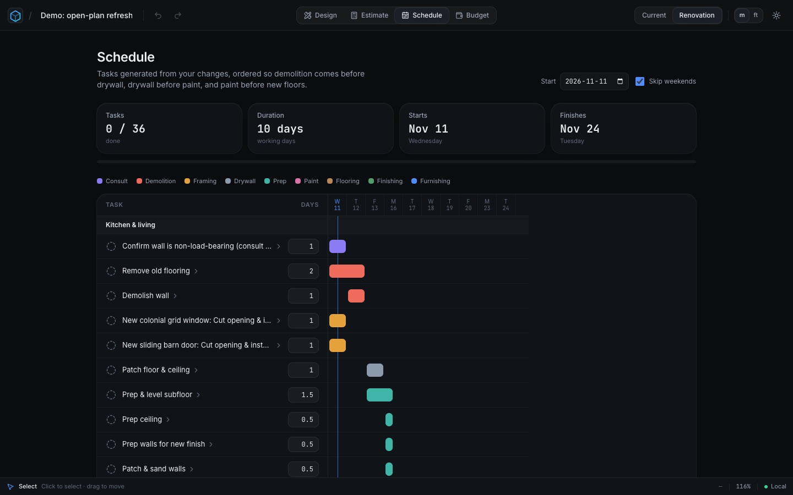
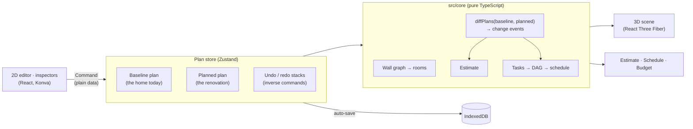

<div align="center">

# Renotion

**Plan your renovation before the first nail.**

Draw your home in 2D, see it in 3D instantly, and get material quantities, costs and a task timeline,
all generated from your plan. Free, no sign-up, runs entirely in your browser.

[](https://github.com/TonyW-Y/Renotion/actions/workflows/ci.yml)




**Try it:** open the app and click **Try the demo**: a furnished sample home with a finished renovation,
no sign-up needed.

</div>

---

## What it does

|                             |                                                                                                                                                                                                                           |
| --------------------------- | ------------------------------------------------------------------------------------------------------------------------------------------------------------------------------------------------------------------------- |
| ✏️ **2D floor-plan editor** | Draw walls with grid, endpoint and angle snapping. Rooms and their areas are detected automatically. Drag corners, walls, doors and windows; undo and redo everything.                                                    |
| 🧊 **Live 3D model**        | Built from the plan on every change: mitred wall corners, real door and window designs, furniture, ceilings. Orbit, top-down or walk through at eye level with wall collision.                                            |
| 🎨 **Finishes**             | 22 floors, 18 wall textures and 6 ceiling finishes (CC0 photo textures at real-world scale), any of them recolourable, plus 24 paints and custom colours. 6 door and 6 window designs, sized freely down to a pet door.   |
| 🛋️ **Furniture**            | 50 pieces in 7 categories, drag-and-drop in 2D or 3D, rotate, resize (with a corner handle), recolour, and price with the estimate or your own number.                                                                    |
| 💰 **Estimate**             | Only what _changes_ between the current home and the renovation is priced: paint in gallons, flooring in sq ft or boxes with waste, trim, drywall sheets, doors, windows, ceilings, furniture. Every price can be edited. |
| 🗓️ **Schedule**             | The changes become an ordered task list (demolition → drywall → paint → floors → furniture) with working-day dates and a Gantt timeline. Track each task's status.                                                        |
| 📒 **Budget**               | Log what you actually spend and compare it with the estimate, by category. Printable project summary.                                                                                                                     |
| 🔌 **Local-first**          | Everything saves to IndexedDB as you work. No account, no server, works offline.                                                                                                                                          |

<table>
  <tr>
    <td></td>
    <td></td>
  </tr>
  <tr>
    <td></td>
    <td></td>
  </tr>
</table>

## Architecture

The plan is the single source of truth. Everything else is **derived** from it, so the 3D model,
estimate and schedule can never disagree with what you drew.



- **Pure core, thin UI.** `src/core/` is framework-free TypeScript (geometry, commands, diffing,
  estimating, scheduling). An ESLint rule forbids it from importing React, Three.js or the DOM, so all
  of it is unit-testable in milliseconds.
- **Command pattern.** Every edit is a serializable command with an exact inverse, which gives
  per-plan undo/redo for free and is the foundation for real-time collaboration later.
- **Two plans, one diff.** The project stores the home _as it is_ and _as planned_. Costs and tasks
  come from `diffPlans`, a typed list of change events (`floorChanged`, `wallRemoved`,
  `openingAdded`, `furnitureAdded`, …).
- **Local-first persistence** behind a `ProjectRepository` interface (IndexedDB today), so a cloud
  backend can be added without touching the editor.

## Interesting problems solved

- **Room detection.** Walls are turned into a planar graph (endpoints merged, T-junctions and
  crossings split), then rooms are found by walking the faces of a half-edge structure. Room names
  and finishes survive edits by matching rooms across versions with Jaccard similarity of their walls.
- **Clean corners without CSG.** Each wall is split into solid boxes around its openings, and wall
  ends are **mitred** (or butted at T-junctions) so no two faces ever overlap. That removed the
  z-fighting flicker at corners. Ceilings sit just above the walls and extend over exterior wall tops.
- **Scheduling as a DAG.** Change events expand into task chains; cross-room rules (all demolition
  before drywall, paint before the floor in the same room, furniture last) add edges; Kahn's
  algorithm orders them, with typed errors for cycles and missing dependencies, then working-day
  date arithmetic lays out the timeline.
- **Estimating like a contractor.** Paint is pooled per room before rounding up to whole gallons,
  flooring adds a per-material waste factor and rounds to boxes, baseboard subtracts door widths,
  resized furniture is priced by footprint.
- **Recolouring photo textures.** One tint function keeps each pixel's brightness relative to the
  texture's average and applies it to the chosen colour, so brick, grain and grout stay visible.
  The same canvas feeds the 2D pattern fill and the 3D colour map, so the two always match.
- **True-to-life colours in 3D.** Default tone mapping and a strong sun made one paint look like
  several colours. The renderer now skips tone mapping and uses a balanced, theme-independent light
  rig, keeping every wall face within a few percent of the colour you picked.
- **Collision.** Furniture uses separating-axis tests against wall footprints; walk mode slides
  along walls and passes through doorways.

## Tech stack and why

| Choice                             | Why                                                                                                                                                       |
| ---------------------------------- | --------------------------------------------------------------------------------------------------------------------------------------------------------- |
| **React 19 + TypeScript (strict)** | `noUncheckedIndexedAccess`, `exactOptionalPropertyTypes`, no `any`. Commands and change events are discriminated unions the compiler checks exhaustively. |
| **Vite 8**                         | Fast dev server; the 3D view is a lazy-loaded chunk so the editor opens quickly.                                                                          |
| **React Three Fiber + drei**       | Declarative Three.js that re-renders from plan data; instancing keeps 50 kinds of furniture cheap.                                                        |
| **react-konva**                    | A fast 2D canvas with hit testing, composite operations and pattern fills.                                                                                |
| **Zustand**                        | Small, unopinionated store; easy to keep undo history next to the plan.                                                                                   |
| **Tailwind CSS 4**                 | Design tokens as CSS variables, with full light and dark themes.                                                                                          |
| **IndexedDB (idb-keyval)**         | Local-first saving with zero setup and no backend cost.                                                                                                   |
| **Vitest + Playwright**            | Fast unit tests for the core, real-browser tests for the flows (with software WebGL in CI).                                                               |
| **Docker + GitHub Actions**        | Reproducible production image and CI that tests the image itself.                                                                                         |

Everything is free: no paid APIs, and every asset is CC0 (see [ASSETS.md](ASSETS.md)).

## Testing

- **234 unit tests** (Vitest) for the core: geometry, room detection, mitring, commands and their
  inverses, diffing, estimates with hand-calculated expected values, tasks and scheduling, the demo
  project's integrity.
- **15 end-to-end tests** (Playwright, real Chromium with software WebGL): drawing rooms, doors and
  windows, undo/redo and persistence, 3D selection sync, furniture placement and collision, resizing
  and recolouring, custom prices, finishes and ceilings, the estimate, schedule and budget, and the demo.
- **CI** runs lint, typecheck, unit tests and build, then the e2e suite, then builds the Docker image,
  smoke-tests it and runs the whole e2e suite **against the container**, and on `main` publishes it
  to GitHub Container Registry.

## Running it

```bash
nvm use            # Node 22+
npm install
npm run dev        # http://localhost:5173
```

| Script                               | What it does                                     |
| ------------------------------------ | ------------------------------------------------ |
| `npm run dev`                        | Vite dev server                                  |
| `npm run build` / `npm run preview`  | Typecheck, build, and serve the production build |
| `npm run lint` · `npm run typecheck` | ESLint (zero warnings) · `tsc` in strict mode    |
| `npm test` · `npm run test:e2e`      | Vitest · Playwright                              |
| `npm run format`                     | Prettier                                         |

### With Docker

```bash
npm run docker:up          # production image on http://localhost:8080
npm run docker:dev         # dev server with hot reload in a container (DEV_PORT=5174 to change)
npm run test:e2e:docker    # Playwright suite in the official image, against the production container
```

The image is a multi-stage build: Node 22 builds the app, then `nginx-unprivileged` (non-root, port 8080) serves it with SPA routing, gzip, long-lived caching for hashed bundles, security headers and a
`/healthz` health check. Published builds: `docker run -p 8080:8080 ghcr.io/tonyw-y/renotion`.

## Keyboard shortcuts

| Key                       | Action                                             |
| ------------------------- | -------------------------------------------------- |
| `V` `W` `D` `N` `F` `X`   | Select · Wall · Door · Window · Furniture · Delete |
| `1` `2` `3`               | 2D · Split · 3D                                    |
| `R` / `Shift+R`           | Rotate selected furniture 90° / 15°                |
| `L`                       | Always show room labels                            |
| `⌘Z` `⇧⌘Z` `⌘D`           | Undo · Redo · Duplicate furniture                  |
| `Del` · `Esc`             | Delete selection · Deselect / back to Select       |
| `W` `A` `S` `D` · `Shift` | Walk mode: move · run (`Esc` releases the mouse)   |

## What I'd do next

- **Cloud sync and share links** with Supabase (auth, row-level security, read-only links), behind the
  existing `ProjectRepository` interface.
- **Real-time collaboration** by broadcasting the existing commands (or moving the plan to a CRDT).
- **glTF furniture** (the catalogue already supports a `gltf` field) and a measuring tool.
- **Regional price data** and labour estimates.

## Credits

Textures and the sky HDRI are CC0 from [Poly Haven](https://polyhaven.com) and
[ambientCG](https://ambientcg.com). Every third-party asset is listed in [ASSETS.md](ASSETS.md).
